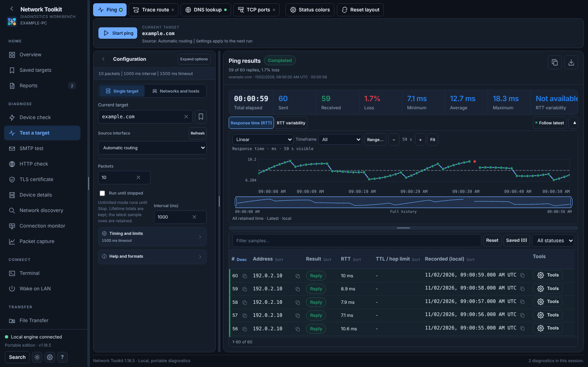
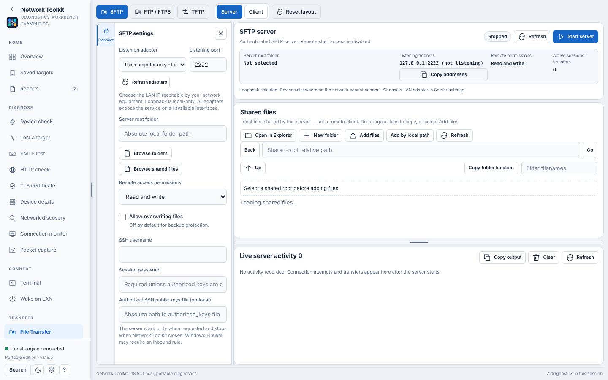

# Network Toolkit

A portable Windows toolkit for network diagnostics, device connections, file transfers and network administration.

Light theme: File Transfer

Screenshots use synthetic example data. Regenerate with `node scripts/readme-screenshots.browser.cjs`.

## Download

[Download the latest stable release](https://github.com/TechSavage1989/network-toolkit/releases/latest).

Latest beta: [v1.19.3](https://github.com/TechSavage1989/network-toolkit/releases/tag/v1.19.3) (opt-in; not a stable release).

## Features

- Test a target: enter a host once and run a device check, Ping, Trace route, DNS lookup, TCP port checks, a continuous monitor or device details from one page.
- Test a website: HTTP and TLS certificate checks for one address; SMTP tests for mail servers.
- Discover network devices and inspect connection details.
- Watch targets with live response-time graphs and inspect packet captures.
- Connect with SSH, Telnet and supported serial terminals, using saved connections, multiple tabs and macros.
- File Transfer: browse, transfer and host files over SFTP, FTP/FTPS and TFTP from one page.
- Open, edit and compare text files, including common network device configurations.
- View local network information and review authorized configuration changes.
- Save preferences and use the built-in updater.

## Requirements

- Windows x64 for the packaged portable application.
- Network access and permissions appropriate to the tools being used.
- Windows administrative approval for protected system changes, when requested.
- Compatible remote services, such as an SSH server with SFTP enabled, for connection-dependent features.

## Getting started

1. Download the stable portable package and extract it to a location you control.
2. Start **Network_Toolkit.exe**.
3. Select a tool from the navigation menu.
4. Enter a target or create a terminal connection, then run only the operations you are authorized to perform.
5. Review any changes to network configuration before confirming them.

## Updates

Use **Check for updates** to check manually. Beta updates are available only after opting in to the beta channel. Downloading and installing an update requires explicit approval; packages are verified before installation. Your saved profiles, settings and credential vault must be preserved.

## Documentation

- [Getting started with diagnostics](docs/guide/diagnostics.md)
- [Terminal](docs/guide/terminal.md)
- [Text Editor](docs/guide/editor.md)
- [File transfers](docs/guide/transfers.md)
- [Network configuration](docs/guide/network-config.md)
- [Settings and updates](docs/guide/settings-and-updates.md)
- [Change history](CHANGELOG.md)
- [UX development plan](docs/UX_POLISH_PLAN.md)
- [Development](docs/DEVELOPMENT.md)

## Building from source

Use the scripts and vendored dependencies already in the repository. See [development instructions](docs/DEVELOPMENT.md) for the supported build and test commands. The distributed Windows executable retains the filename **Network_Toolkit.exe**.

## Responsible use

Use scanning, configuration, capture and connection features only on networks and systems you own or are authorized to administer. Protected system changes require review and Windows approval. Keep credentials private and check the destination before transferring or overwriting files.
